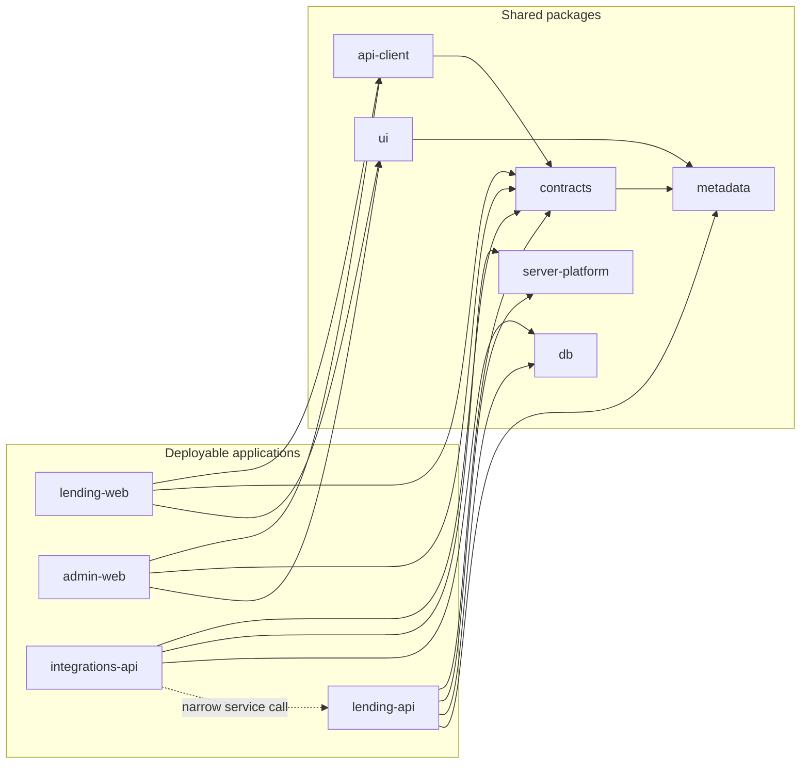
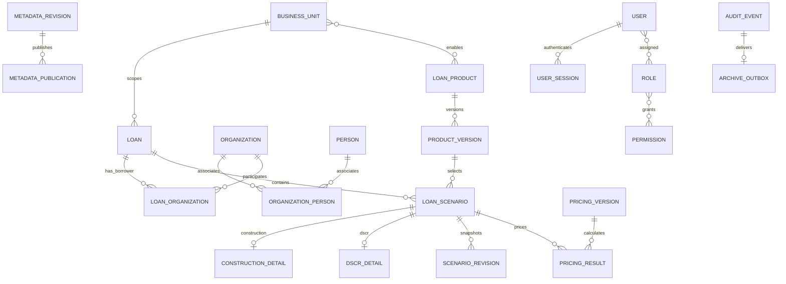
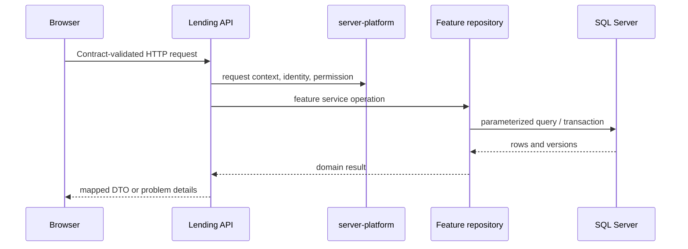

# Architecture overview

The workspace contains four deployable applications with shared, versioned-in-repository packages. Workspace boundaries separate business ownership and runtime responsibilities while allowing one reviewed change to update a database migration, API contract, and consuming UI together.

## Dependency direction

The integrations API stores provider idempotency state in its own schema. It asks the lending API to perform lending writes through a narrow service identity and does not import lending repositories. Public DTOs are defined once in `packages/contracts`; browser code reaches them through `packages/api-client`.

## Domain model

Core lending values use typed relational columns and decimal arithmetic. Metadata documents and bounded pricing/scenario snapshots use validated JSON; those documents do not define arbitrary columns or SQL. The table and constraint definitions live in `packages/db/src/migrations`.

## Request paths

Scenario writes use an expected row version and write the scenario, audit event, and archive outbox entry in one SQL transaction. A stale version returns a conflict and leaves the caller's changes available for recovery. Telemetry is best-effort and does not participate in that transaction.
